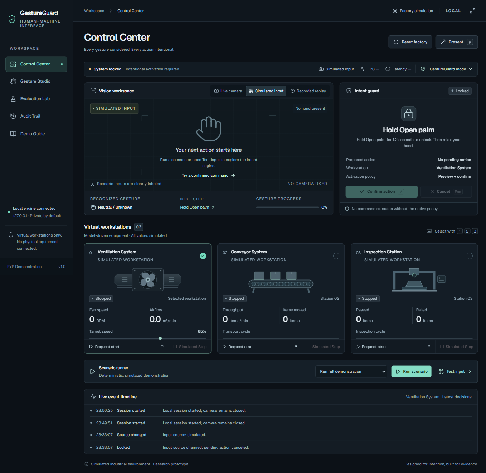
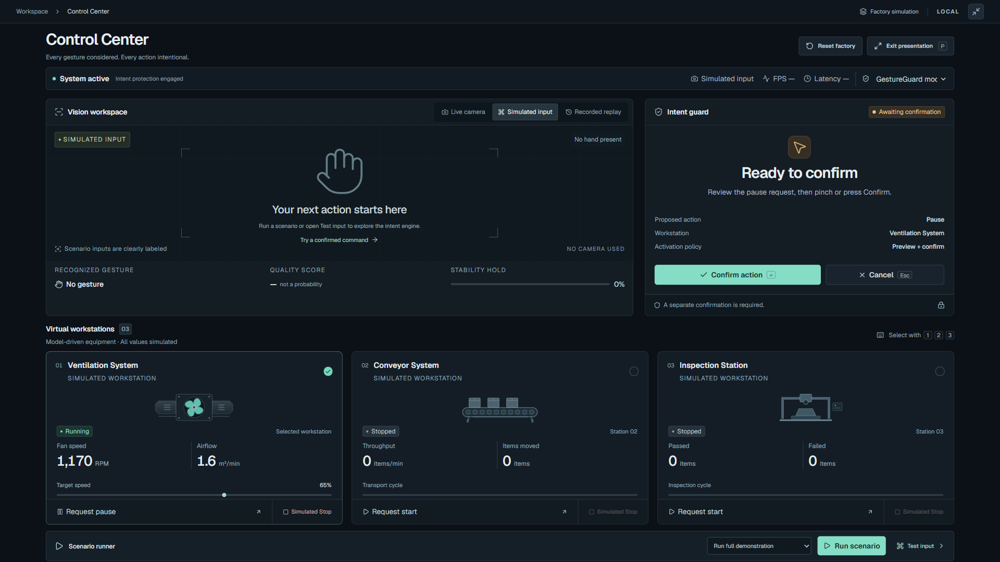
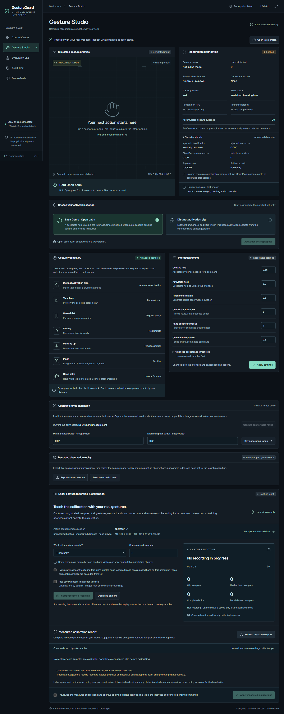

# GestureGuard HMI

**An Intent-Aware Touchless Human–Machine Interface Using Computer Vision for Simulated Industrial Workstations**

A local-first Diploma in Computer Science FYP that separates **recognizing a hand gesture** from **authorizing a command**. Python tracks hands, interprets intent, controls three deterministic virtual workstations, and records auditable events. A React interface makes every detected, pending, rejected, and executed action visible.

This application controls simulations only. It does not connect to machinery, industrial PLCs, mains electricity, or operating-system automation. “Simulated Stop” is a simulation control, not an emergency-stop safety system. The project makes no claim of certified safety, perfect recognition, or calibrated confidence probabilities.



## What the project demonstrates

Ordinary gesture mapping can commit an unintended action as soon as a hand shape is recognized. GestureGuard adds an explicit interaction architecture:

- Easy Demo Open Palm activation, a configurable distinct activation alternative, and automatic locking.
- Elapsed-time temporal consensus, category hysteresis, brief fluctuation tolerance, neutral release, cooldown, and repeated-gesture suppression.
- Context-aware command permissions tied to a selected workstation.
- A visible action preview and separate pinch/manual confirmation before start/pause.
- Brief instability pauses evidence; sustained loss/insufficient evidence, ambiguity, multiple hands, timeout, and changed context prevent commitment.
- Structured SQLite audit events, observation replay, annotated evaluation metrics, and a reproducible three-mode comparison.

MediaPipe supplies the pretrained model. **The original contribution is the Python command-intention architecture and its evaluation**, not a newly trained gesture classifier. See [architecture and contribution](docs/ARCHITECTURE.md).

## Main screens

| Screen | Purpose |
|---|---|
| Control Center | Camera/source status, landmark preview, intent progress, simulated stations, manual controls, and recent events |
| Gesture Studio | Gesture mappings, adjustable holds/thresholds, and image-space operating-range calibration |
| Evaluation Lab | Session/condition filters, genuine event metrics, ground-truth annotations, and deterministic A/B/C comparison |
| Audit Trail | Searchable source-attributed event history and CSV/JSON export |
| Demo Guide | Operating instructions, prepared scenarios, and presentation support |

Presentation Mode increases operational visibility and reduces navigation distraction. Live Camera, Recorded Replay, and Simulated Test Input are visibly distinguished. A camera failure does not prevent use of the simulation, scenario runner, manual fallback, audit, or comparison.



## Quick start on Windows

Prerequisites: **Python 3.11**, a supported 64-bit Windows computer, **Node.js 22.12+ or 24**, and npm. The tested Python environment for this build is 3.11.9. A webcam is required only for live recognition. Initial installation downloads open-source packages and the MediaPipe model; operation after setup requires no cloud account, paid API, or internet connection.

From this repository root in PowerShell:

```powershell
Set-ExecutionPolicy -Scope Process Bypass
.\scripts\install.ps1
.\scripts\start.ps1
```

Open **http://127.0.0.1:8765**. The launcher serves the built frontend and API from one local process. Press **Ctrl+C** in that terminal to shut down and release the camera. The default binding is `127.0.0.1`; do not change it to a public interface for a classroom demonstration.

The installer creates `.venv`, installs the pinned Python lockfile, downloads the model into `models/`, installs frontend packages with `npm ci`, and builds the interface. Model files, virtual environments, `node_modules`, generated builds, and runtime audit data are excluded from version control. No personal paths or credentials are needed.

Manual setup:

```powershell
py -3.11 -m venv .venv
.\.venv\Scripts\python.exe -m pip install -r requirements-lock.txt
.\.venv\Scripts\python.exe scripts/download_model.py
Set-Location frontend
npm ci
npm run build
Set-Location ..
.\.venv\Scripts\python.exe -m uvicorn gestureguard.api:app --app-dir backend --host 127.0.0.1 --port 8765
```

For frontend development, run the same backend in one terminal and `npm run dev` from `frontend` in another. Vite binds locally and proxies `/api` and `/ws` to the backend; open its printed local URL, normally http://127.0.0.1:5173. Use the one-process built version for the FYP presentation.

## First interaction

1. Keep **GestureGuard** selected and reset the virtual factory. It starts stopped and LOCKED.
2. Choose **Live Camera**, or keep **Simulated Test Input** for an honestly labeled architecture demonstration.
3. In **Easy Demo**, hold **Open Palm** until unlock completes, then relax/release. Gesture Studio also offers the distinct **ILoveYou** activation sign.
4. Hold **Thumb Up**. Watch the candidate progress and start preview for the selected station.
5. Make a separate **Pinch** to confirm, or use explicit manual Confirm. The station runs only after the backend commits.
6. Release before repeating. Use **Open Palm** to cancel. Sustained hand absence locks the protected interface.

| Gesture | Interaction |
|---|---|
| ILoveYou | Configurable distinct activation alternative |
| Open Palm | Deliberate unlock while locked in Easy Demo; short stable cancel / neutral when unlocked |
| Closed Fist | Request pause |
| Thumb Up | Request start |
| Victory | Select next station |
| Pointing Up | Select previous station |
| Pinch | Confirm |

Pinch is computed from normalized thumb/index geometry. The operating-range setting is based on image-space hand scale, **not physical centimeters**. Do not treat landmark `z` coordinates as calibrated depth or category scores as probabilities of safe intent.

Recorded metadata identifies `score_kind`: `classifier_output` for pretrained gesture categories, or `geometric_quality_index` for the pinch heuristic. These two scores have different meanings and neither is a calibrated confidence probability. The hand-scale proxy is palm width relative to image width, with aspect-ratio correction; it is not a physical distance measurement.

## Three control configurations

| Mode | Interaction protections |
|---|---|
| Baseline | Minimal gesture-to-command mapping in the isolated factory |
| Protected | Deliberate unlock, stability, release detection, and cooldown |
| GestureGuard | Protected behavior plus context validation, uncertainty rejection, explicit preview, separate confirmation, and explanatory audit |

The factory's own state model prevents impossible operations in every mode. The comparison runs fresh engines with identical scripted observations and settings; its fixture/configuration hashes make the input reproducible. **Scripted comparison outcomes are not human recognition benchmarks.**


## Recognition usability update

GestureGuard now separates raw classification, geometric interpretation, supported temporal evidence, and authorized commands. The default classifier threshold remains **0.70**. Brief weak/unknown frames pause evidence instead of immediately resetting a hold and latching release. Consistent moderate scores can qualify through a longer hold and stronger time-window agreement; the raw scores are never raised or presented as calibrated probabilities. These filter defaults are provisional engineering settings, not fitted human results.

Geometric Pinch uses its explicit normalized distance rule and an extended-index guard against curled fists. It is not gated by a classifier probability threshold. Multi-hand ambiguity still cancels immediately; sustained tracking loss cancels pending intent and later locks. Preview, separate confirmation, cooldown and release gating remain in Python.

Open **Gesture Studio** for live preview, raw versus interpreted/filtered classification, candidate, threshold units, tracking, hold interruptions, and exact decision reasons. Lowering a threshold is not the first troubleshooting step.

### Voluntary local recording and calibration

1. Select a streaming **Live Camera**, set a pseudonymous operator/session and conditions, and open the recording panel.
2. Choose a gesture, **Neutral hand position**, or **Negative non-command movements**. Record all labels over different orientations, backgrounds, distances and independent sessions.
3. Explicitly consent for each short clip. Landmark recording is local; optional camera images are **off by default**. Commands are locked while collecting samples.
4. Inspect the measured calibration report. Suggestions require repeated matching positives and visible-hand negative examples, remain provisional, and need a separate explicit Apply approval. Pinch geometry is reported separately.

Files stay under ignored `data/recordings/`. Never publish participant images, landmarks, or trained personal-data artifacts. No recordings are created from simulated or replay input.

Optional offline training is available through `scripts/train_classifier.py`; dependencies are isolated in `requirements-training.txt` and are not required to run the app. It requires group-disjoint human data, all labels and negatives. Models are numerical JSON, never executable pickle, and are **not automatically enabled for live control**. The paired evaluator reports per-gesture metrics/confusion and hold-component differences while leaving unavailable full-task/false-activation metrics empty.

```powershell
.\.venv\Scripts\python.exe scripts/evaluate_recordings.py
# After collecting independent held-out human sessions, see the exact split/training commands:
# docs/HUMAN_DATA_AND_TRAINING.md
```

There are currently **no labeled human training clips, no before/after human accuracy result, and no trained/deployed custom model**. Existing unlabeled live audit observations support the score-gating diagnosis but are not ground truth. HaGRID and Jester were researched; their licenses, size and incomplete label match are documented in [human-data and training notes](docs/HUMAN_DATA_AND_TRAINING.md). HaGRID's exact license is custom, not plain CC BY-SA. The original MediaPipe recognizer remains the selected model. See [recognition diagnosis](docs/RECOGNITION_USABILITY.md).



## Simulated workstations

- **Ventilation:** start/pause/stop, adjustable target speed, fan visualization, modeled RPM and airflow.
- **Conveyor:** modeled movement/throughput and elapsed-time item counting.
- **Inspection:** deterministic inspection progress and pass/fail counters.

Every visualization reflects Python model state. Displayed equipment values are simulated, not physical sensor readings. Manual controls are an accessibility/testing fallback, with their source recorded. Start/pause in GestureGuard use preview/confirmation; Simulated Stop directly affects only the virtual model.

## Tests and verification

```powershell
.\.venv\Scripts\python.exe -m pytest backend/tests -q
Set-Location frontend
npm run build
```

The suite covers the finite-state machine, repeated-gesture suppression, timeout, tracking-loss cancellation, changed context, invalid commands, mode differences, deterministic simulation, event serialization, observation replay, honest empty evaluation states, annotation denominators, and deterministic comparison. The build type-checks the frontend before bundling it.

Screenshots in [screenshots](screenshots) are captured from the running interface, not design mockups. See the final delivery/testing record for the latest observed test counts and webcam verification status; this README deliberately does not claim unmeasured FPS, recognition accuracy, participant results, or completed real-camera acceptance.

The [verification record](docs/VERIFICATION.md) lists the tested build, browser checks, screenshots, and remaining hardware work. Real-time replay is a presentation playback on a 20 Hz coordinator; very short intervals may be skipped. Use the exact offline equivalent-stream comparison and logged-observation tests for deterministic architecture evaluation.

Before the live presentation, verify camera permission, hand tracking and landmarks, each mapped gesture, comfortable image-space range, lighting, hand-loss cancellation, sustained absence locking, and actual FPS/latency on the **presentation laptop**. Keep the labeled simulated scenario fallback ready. Real-hardware performance varies by camera, CPU, background, lighting, skin visibility, pose, and glove.

## Evaluation and data

Evaluation values are computed from recorded application events with sample counts and units. Unsupported measures remain empty. Expected-gesture labels are required for accuracy; reviewed command labels and measured idle exposure are required for false activations; explicit task results are required for completion rate/time. Rejecting a gesture is not automatically a failed task.

Create pseudonymous sessions with operator, lighting, distance, and glove labels. Use `POST /api/annotation` to append ground-truth records; do not alter original events. Supported annotations:

```json
{"type":"recognition_label","expected":"Thumb_Up","predicted":"Thumb_Up"}
{"type":"command_label","event_id":42,"intended":false,"idle":true}
{"type":"idle_exposure","duration_seconds":60}
{"type":"task_result","success":true,"duration_seconds":8.4}
```

Check the API's interactive schema at http://127.0.0.1:8765/docs for the exact request envelope. Export audit and evaluation records as CSV/JSON. Keep live-camera human trials separate from simulated or replayed inputs. Observation replay tests the command architecture; it does not rerun model inference on recorded images.

The proposed [evaluation protocol](docs/EVALUATION_PROTOCOL.md) describes practice/pilot trials, counterbalanced mode orders, annotations, metrics, repeatability, limitations, and the remaining participant study. No experimental results are fabricated or prefilled.

## Architecture

```text
backend/gestureguard/
  vision.py                Background webcam capture and inference
  gesture_recognition.py   Category/landmark interpretation and pinch geometry
  domain.py                Typed observations, settings, gestures, states
  intent_engine.py         Hardware-independent command-intention state machine
  command_router.py        Station/context permission checks
  simulation.py            Deterministic virtual factory
  event_store.py           SQLite persistence and event serialization
  evaluation.py            Recorded metrics and reproducible comparison
  runtime.py               Threaded application/source coordinator
  api.py                   Local HTTP, WebSocket, exports, static UI
backend/tests/             Automated verification
frontend/                  React + TypeScript + Vite interface
fixtures/                  Explicitly labeled observation streams
scripts/                   Installation, startup, model download
docs/                      Architecture, demo, evaluation, source/license notes
hardware/                  Optional parameterized OpenSCAD webcam support
screenshots/               Actual interface captures
```

All authorization and command logic lives in Python and can be tested without a camera. Monotonic timestamps measure durations; UTC timestamps support readable audit history. Capture/inference and application updates are decoupled from HTTP/WebSocket handling. The browser displays authoritative snapshots and sends explicit intentions.

## Technology and dependencies

The Python requirements pin FastAPI, Uvicorn, MediaPipe 0.10.21, NumPy 1.26.4, OpenCV Contrib 4.11.0.86, pytest, and HTTPX. Python 3.11 is used to keep this verified MediaPipe/OpenCV combination reproducible. Frontend dependencies include React 19, TypeScript, Vite 7, Tailwind CSS 4, Motion, Lucide, and locally bundled Geist typography. Lockfiles record exact resolved packages.

See [dependency and license notes](docs/DEPENDENCIES_AND_LICENSES.md) for official sources and upstream licensing. The official float16 Gesture Recognizer model bundle, version 1, is downloaded separately and is not original trained work. The downloader writes its source URL, byte length, version, and SHA-256 into `models/model-manifest.json`; `.task` weights are excluded from Git. Review transitive notices before distributing an installer.

## Presentation and remaining FYP work

Use the [five-minute demonstration script](docs/DEMO_SCRIPT.md). Show a locked accidental gesture, deliberate unlock, visible preview, confirmed action, uncertainty/context rejection, automatic locking, three-mode scripted comparison, and exportable audit. Keep the input-source label visible and explain exactly what is measured.

Remaining academic work includes testing on the final webcam/laptop, freezing calibrated settings, obtaining supervisor-approved participant consent, collecting counterbalanced labeled trials and reviewed idle exposure, analyzing exported data, and writing limitations. Optional [3D-printable support source](hardware/README.md) improves placement repeatability but has not been printed or load-tested. No ESP32 or physical machinery integration is required.

## Troubleshooting

| Symptom | Check |
|---|---|
| Python launcher selects 3.14 | Use `py -3.11` and the project `.venv` |
| Model unavailable | Run `scripts/download_model.py` with the virtual-environment Python; review download error and network access |
| Camera unavailable or in use | Close other camera apps, check OS camera privacy permissions, then switch Live Camera again |
| No stable recognition | Improve even lighting, show one hand fully, reduce motion, adjust holds/thresholds and image-space range |
| Commands remain locked | Hold Open Palm in Easy Demo (or the configured distinct sign), then release before issuing a command |
| Preview expires | Release and make a separate pinch within the configured confirmation window |
| Interface disconnected | Check backend terminal and local port 8765; reload after restart |
| No evaluation accuracy | Collect valid expected/predicted trial labels; simulated observations alone cannot establish vision accuracy |
| Port already occupied | Stop the previous application instance before starting another |

The audit database and saved settings are runtime data. Preserve exports for the report before clearing local data. Do not publish participant identifiers or camera recordings in the public repository.
